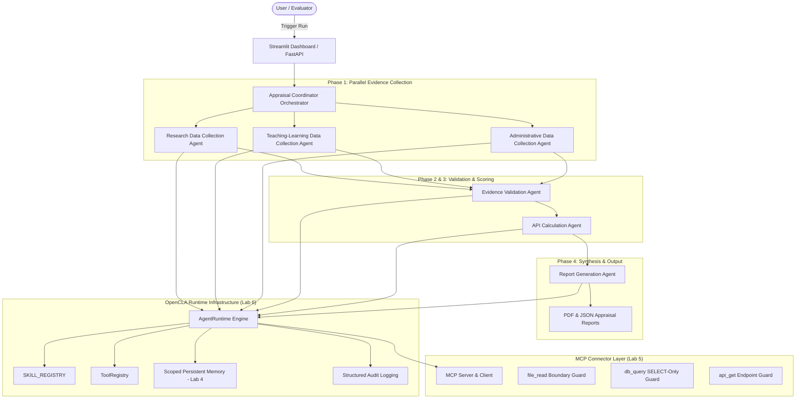

# Architecture Overview: Faculty Appraisal Management System

**Course:** Agentic AI  
**Scope:** Comprehensive Labs 1–12 (Runtime, MCP, Memory, Node Graphs, Swarms, Deep Research, Cloud Ops, SDLC, Governance)  
**Status:** Educational prototype using synthetic data only  
**Disclaimer:** *Demo Appraisal Policy — configurable; not official institutional scoring policy.*

---

## 1. High-Level System Architecture

The Faculty Appraisal Management System is structured as a multi-agent architecture powered by a generic, registry-based runtime (`OpenCLA/OpenClaw` style), an educational Model Context Protocol (MCP) connector, and scoped persistent memory.

---

## 2. Six Domain Agents + Coordinator

| Entity | Role | Responsibilities | Agentic Cycle |
|---|---|---|---|
| **Coordinator** | Orchestrator (Infrastructure) | Coordinates parallel collection, manages state transitions, handles errors | Orchestrates pipeline |
| **Research Agent** | Domain Agent 1 | Gathers publications, conferences, patents, projects from CSVs/PDFs | Plan ➔ Act ➔ Observe ➔ Decide |
| **Teaching Agent** | Domain Agent 2 | Analyzes courses, attendance records, student evaluations, pass rates | Plan ➔ Act ➔ Observe ➔ Decide |
| **Administration Agent** | Domain Agent 3 | Extracts committee memberships, coordinator roles, institutional activities | Plan ➔ Act ➔ Observe ➔ Decide |
| **Evidence Validation Agent** | Domain Agent 4 | Validates file existence, format readability, completeness, flags duplicates | Plan ➔ Act ➔ Observe ➔ Decide |
| **API Calculation Agent** | Domain Agent 5 | Deterministically calculates scores based strictly on VALID evidence | Plan ➔ Act ➔ Observe ➔ Decide |
| **Report Generation Agent** | Domain Agent 6 | Generates PDF & JSON drafts marked "Awaiting Human Review" | Plan ➔ Act ➔ Observe ➔ Decide |

---

## 3. Core Principles & Design Decisions

1. **Deterministic Scoring (No LLM Hallucinations):** Scoring is evaluated strictly using criteria defined in `config/scoring_rules.json`.
2. **Registry-Based Runtime:** New skills can be registered dynamically without modifying any line of `AgentRuntime.run_task` or adding `if/elif` ladders.
3. **Strict Memory Isolation:** Scoped key-value store backed by SQLite isolates data per faculty identifier (`faculty:FAC001`).
4. **Security Boundaries in MCP:**
   - Database queries are restricted strictly to `SELECT`.
   - File reads are restricted to the faculty's home directory (`data/faculty/{faculty_id}`).
   - API endpoints are matched against an explicit whitelist.
5. **Human-in-the-Loop:** Appraisals are designated `DRAFT` until an authorized evaluator reviews and approves the report.
