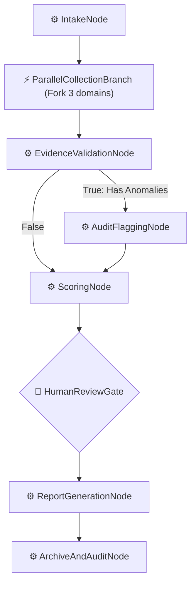

# Lab 7: Agentic Node Graph Architecture

## 1. Concept Overview
A linear pipeline executes sequentially without the ability to dynamically branch, route around failures, loop back, or pause for human approval. **Agentic Node Graphs** structure workflows as an explicit **Directed Acyclic Graph (DAG)** of stateful nodes and conditional edges.

## 2. Implementation in Team 8 (Faculty Appraisal)
In `app/graph/`:
- **StateGraph:** Graph engine compiling and coordinating node execution.
- **ParallelBranchNode:** Executes data collection concurrently for Research, Teaching, and Administration, merging state updates.
- **ConditionEdge:** Dynamic decision edge evaluating evidence anomalies (`has_anomalies`). If validation flags unverified or invalid records, routes to `AuditFlaggingNode`; otherwise advances directly to `ScoringNode`.
- **HumanGateNode:** Halts execution at `HumanReviewGate`, serializes a state checkpoint (`CKPT-{id}`), and waits for human evaluator approval to resume.

## 3. Mermaid DAG Topology


## 4. Verification & Testing
Run automated unit tests:
```bash
python run.py graph
```
Or via pytest:
```bash
pytest tests/test_concepts_7_to_12.py -k test_node_graph
```

